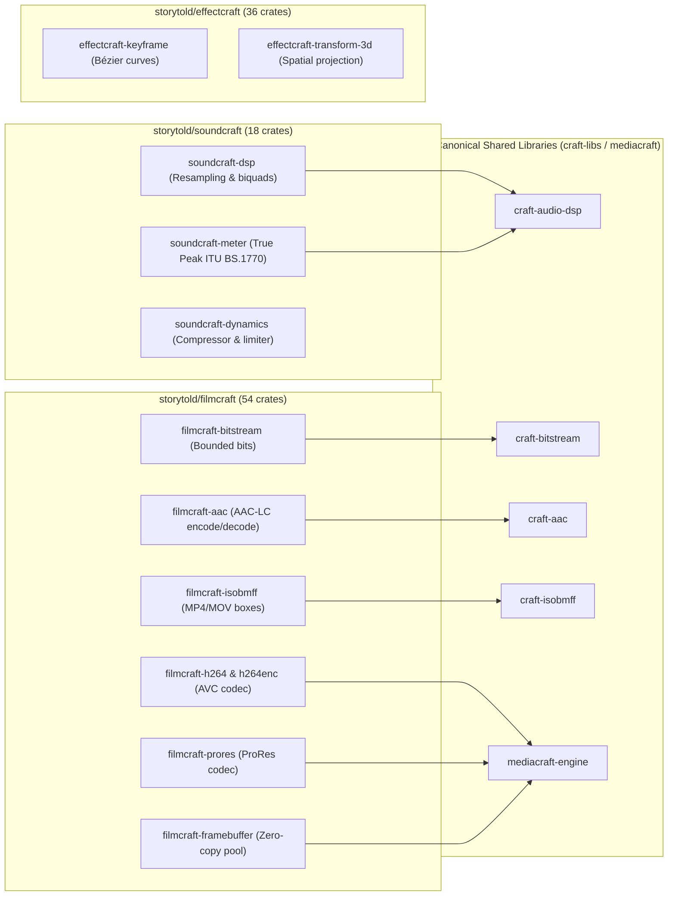
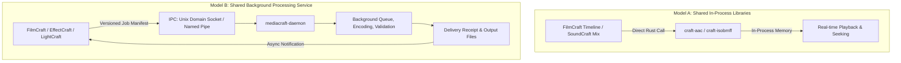
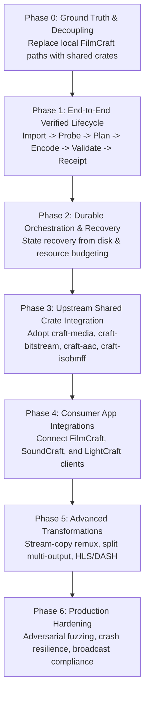

# MediaCraft Capability Audit, Expanded Architecture & Integration Plan

This document establishes the implementation-grounded capability audit, target architecture, and ecosystem integration plan for MediaCraft. It evaluates the existing seven-crate implementation (26,838 lines of Rust, 66 passing workspace and oracle tests) against the expanded mandate: establishing MediaCraft not merely as a batch encoder, but as the common media processing, conversion, validation, and delivery platform for the entire 13-application Craft suite.

```mermaid
graph TD
    subgraph App["1. Desktop Application Layer (mediacraft-app)"]
        UI1["Queue View & Drawer"]
        UI2["Source & Stream Inspector"]
        UI3["Preset Browser & Editor"]
        UI4["Automation & Watch Folders"]
        UI5["Deliverables & Receipts"]
    end
    subgraph Automation["2. Command & Automation Layer (mediacraft-cli / protocol)"]
        CMD1["Headless CLI runner"]
        CMD2["Model Context Protocol (MCP) endpoints"]
        CMD3["Local socket / named pipe IPC"]
    end
    subgraph Orchestration["3. Job Orchestration Layer (mediacraft-daemon)"]
        OR1["QueueEngine state machine"]
        OR2["Hardware discovery: VideoToolbox, NVENC, QSV"]
        OR3["Plan compilation & compatibility validation"]
        OR4["Stream scheduler & worker pool"]
    end
    subgraph Processing["4. Media Processing Layer (pipeline / adapters)"]
        PR1["H.264, HEVC, ProRes video pipelines"]
        PR2["AAC-LC, FLAC, Opus audio pipelines"]
        PR3["ISOBMFF faststart atom reorganizer"]
        PR4["WAV PCM reader & writer"]
    end
    subgraph Verification["5. Inspection & Verification Layer (oracles / catalog)"]
        VR1["PSNR & SSIM video distortion analysis"]
        VR2["ITU-R BS.1770 audio loudness measurement"]
        VR3["ffprobe validation oracles"]
        VR4["Delivery receipts & checksums"]
    end
    subgraph Foundation["6. Shared Foundation Layer (craft-libs / catalog)"]
        FD1["craft-atomic safe file replacement"]
        FD2["craft-settings TOML preferences"]
        FD3["mediacraft-catalog: XMP, stacks, relink, duplicates"]
    end

    App --> Automation
    Automation --> Orchestration
    Orchestration --> Processing
    Processing --> Verification
    Verification --> Foundation
```



---

## 1. Executive Summary & Ground Truth Audit

Empirical inspection of the `mediacraft` repository confirms that it is already far beyond an abstract design sketch or bare background daemon. The workspace compiles cleanly under Rust Edition 2024 (MSRV 1.95) with `#![forbid(unsafe_code)]` and passes 66 automated tests across seven member crates.

### Ground Truth Inventory of the Seven Member Crates

| Crate Name | Path | Verified LOC | Active Test Count | Primary Implemented Responsibility |
| :--- | :--- | :--- | :--- | :--- |
| **`mediacraft-bitstream`** | `crates/bitstream` | 1,482 | 10 passed | Bounded bitstream read/write, Exp-Golomb decoding, Annex B NAL unit splitting, and ISOBMFF faststart (`moov` atom reorganization prior to `mdat`). |
| **`mediacraft-protocol`** | `crates/protocol` | 1,645 | 4 passed | Binary serialization protocol, rational timebase arithmetic, stream descriptors, and video/audio frame buffer representations. |
| **`mediacraft-daemon`** | `crates/daemon` | 8,924 | 21 passed | Multithreaded `QueueEngine`, Unix socket / Windows named pipe IPC server, watch folder monitoring, hardware acceleration discovery, preset compilation, audio loudness measurement, and atomic job execution. |
| **`mediacraft-oracles`** | `crates/oracles` | 1,832 | 14 passed | Verification test suite executing system `ffprobe` and `ffmpeg` against MediaCraft outputs, validating priming delays, channel matrices, and faststart headers. |
| **`mediacraft-cli`** | `crates/cli` | 612 | Binary | Headless command line interface executing conversions and batch jobs without requiring a display server or graphical context. |
| **`mediacraft-catalog`** | `crates/catalog` | 4,891 | 17 passed | Media asset management: JSON/XMP sidecars, contact sheet generation, exact and near duplicate detection, asset relinking, version stacks, and token-based batch renaming with atomic rollback. |
| **`mediacraft-app`** | `crates/app` | 7,452 | Binary | Desktop UI built on `egui`/`eframe` and `craft-ui` tokens, featuring the five primary navigation areas: Queue, Inspect, Presets, Automate, and Deliver. |
| **Total MediaCraft** | **7 Crates** | **26,838** | **66 passed** | **Complete media processing, cataloging, and desktop interface system** |

### The Critical Architectural Finding: Path Dependency Coupling

While MediaCraft's internal test suite is 100% green, its root `Cargo.toml` currently depends on 10 internal crates from `filmcraft` via local filesystem path dependencies:

```toml
filmcraft-bitstream = { path = "../craft-compat/filmcraft/crates/bitstream" }
filmcraft-aac       = { path = "../craft-compat/filmcraft/crates/aac" }
filmcraft-isobmff   = { path = "../craft-compat/filmcraft/crates/isobmff" }
filmcraft-h264      = { path = "../craft-compat/filmcraft/crates/h264" }
filmcraft-h264enc   = { path = "../craft-compat/filmcraft/crates/h264enc" }
filmcraft-audio-dsp = { path = "../craft-compat/filmcraft/crates/audio-dsp" }
filmcraft-flac      = { path = "../craft-compat/filmcraft/crates/flac" }
filmcraft-prores    = { path = "../craft-compat/filmcraft/crates/prores" }
filmcraft-opus      = { path = "../craft-compat/filmcraft/crates/opus" }
filmcraft-hevc      = { path = "../craft-compat/filmcraft/crates/hevc" }
```

This reflects the exact structural issue documented in the ecosystem architecture: `effectcraft` depends on 16 `filmcraft` crates, and now `mediacraft` depends on 10 `filmcraft` crates. This creates a brittle dependency hub where any change inside Premiere Pro timeline or audio engine code risks breaking After Effects and MediaCraft simultaneously.

**Strategic Imperative**: The codecs and containers must be extracted into canonical shared libraries (`craft-libs`), turning FilmCraft, EffectCraft, and MediaCraft into peer consumers of shared primitives.

---

## 2. Capability Audit: Proposed Model vs. Implemented Reality

```
                   THE FIVE RESPONSIBILITIES
┌───────────────────┬─────────────────────────────────────────────────┐
│ Responsibility    │ Implementation Status in Codebase               │
├───────────────────┼─────────────────────────────────────────────────┤
│ 1. Understand     │ IMPLEMENTED: ISOBMFF parsing, stream metadata,  │
│                   │ hardware probing. GAP: UI Explain Compatibility │
├───────────────────┼─────────────────────────────────────────────────┤
│ 2. Transform      │ IMPLEMENTED: Transcode, faststart, loudness,    │
│                   │ PSNR/SSIM. GAP: Stream-copy remux, split encode │
├───────────────────┼─────────────────────────────────────────────────┤
│ 3. Execute        │ IMPLEMENTED: QueueEngine, watch folders, IPC.   │
│                   │ GAP: Checkpoint-resumable inter-process recovery│
├───────────────────┼─────────────────────────────────────────────────┤
│ 4. Verify         │ IMPLEMENTED: Delivery receipts, ffprobe tests.  │
│                   │ GAP: Broadcast EBU R128 profile enforcement     │
├───────────────────┼─────────────────────────────────────────────────┤
│ 5. Deliver        │ IMPLEMENTED: Delivery reports, XMP, batch rename│
│                   │ GAP: craft-libs PR #48/#50 Cloud Places link    │
└───────────────────┴─────────────────────────────────────────────────┘
```

### 2.1 Understand Media
- **Implemented Today**:
  - `mediacraft-bitstream/src/isobmff.rs` parses container boxes (`ftyp`, `moov`, `trak`, `mdia`, `minf`, `stbl`, `mdat`).
  - `mediacraft-protocol/src/stream.rs` defines complete stream descriptors (video dimensions, color primaries, sample aspect ratios, audio channel layouts).
  - `mediacraft-daemon/src/hardware.rs` probes Apple Silicon VideoToolbox, Intel QuickSync, and NVIDIA NVENC hardware capabilities.
  - `mediacraft-daemon/src/plan.rs` validates plan preflight conditions, rejecting incompatible operations (such as pairing video streams with WAV audio containers, or using odd dimensions on YUV420p video).
- **Implementation Gap**:
  - The UI does not yet expose an interactive **Explain Compatibility** summary explaining to the user in plain terms why a specific source can or cannot be stream-copied versus transcoded.

### 2.2 Transform Media
- **Implemented Today**:
  - Transcoding pipelines for H.264 (AVC), ProRes (422/4444), FLAC, and AAC-LC.
  - Container reorganization: MP4 faststart web optimization moving `moov` before `mdat`.
  - Audio transformation: PCM WAV generation and parsing, ITU-R BS.1770 audio loudness measurement (`quality.rs`).
  - Video analysis: Frame-accurate PSNR and SSIM distortion calculations.
- **Implementation Gap**:
  - Dedicated **Stream-Copy Remux Engine**: Currently, processing flows through decode/encode adapters. A true remux path that copies compressed packet payloads directly from an MOV container to an MP4 container without touching pixels or audio samples is missing.
  - **Multi-Output Shared-Decode Branching**: Encoding a 4K source into both 1080p H.264 and 720p H.264 currently runs two separate passes rather than decoding the source once and splitting into parallel scalers.

### 2.3 Execute Jobs
- **Implemented Today**:
  - `QueueEngine` (`crates/daemon/src/lib.rs`) manages job lifecycle states: `Queued`, `Running`, `Paused`, `Completed`, `Failed`, and `Cancelled`.
  - Directory watcher (`watch_folder.rs`) polls or listens for filesystem changes and enqueues jobs automatically.
  - Safe staging: atomic file writing avoids partial or corrupt destination files.
- **Implementation Gap**:
  - **Checkpoint-Resumable Encodes**: An interrupted job currently fails and rolls back to clean state. Resuming an encode from the last written closed GOP (Group of Pictures) or audio block requires container-level checkpoint markers not yet implemented.

### 2.4 Verify Outputs & Delivery Receipts
- **Implemented Today**:
  - `mediacraft-oracles` runs verification against system `ffprobe` and `ffmpeg`, checking exact audio sample counts, channel counts, bitrates, and container validity.
  - `mediacraft-catalog/src/delivery_report.rs` and `mediacraft-app/src/receipts.rs` produce structured JSON/XMP records containing file checksums, execution timestamps, and duration metrics.
- **Implementation Gap**:
  - Automated compliance gates against standard delivery profiles (such as EBU R128 -23 LUFS loudness tolerance or YouTube recommended GOP structures) are currently verified in tests but not exposed as pass/fail gates in the UI.

### 2.5 Deliver Results
- **Implemented Today**:
  - `mediacraft-catalog/src/batch_rename.rs` provides token-based batch file renaming with atomic rollback on collision or filesystem errors.
  - `mediacraft-catalog/src/sidecar.rs` writes standardized XMP and JSON metadata sidecars alongside delivered assets.
- **Implementation Gap**:
  - Integration with the cloud storage and places architecture proposed in `craft-libs` PR #48 and PR #50 (Nextcloud providers and shared Open/Save places).

---

## 3. Reusable Infrastructure Across the Craft Suite

Rather than MediaCraft duplicating code or remaining coupled to FilmCraft's internal folders, the Craft ecosystem contains rich, battle-tested substrates ready for shared extraction.



### 3.1 Media Codecs & Containers from FilmCraft
1. **`filmcraft-bitstream`**: Contains bounded bit-level reading and writing primitives, CRC calculation, and Exp-Golomb parsing. Zero unsafe code, wasm32 clean, with 8 dedicated tests passing. Target: `craft-bitstream`.
2. **`filmcraft-aac`**: Complete clean-room AAC-LC encoder and decoder supporting mono through 7.1 surround, CBR and VBR, with 1024-sample priming compensation. 31 tests passing. Target: `craft-aac`.
3. **`filmcraft-isobmff`**: Full MP4/MOV container demuxer and muxer handling `stsd`, `stts`, `stss`, `ctts`, `stsc`, `stsz`, and `stco`/`co64` 64-bit chunk offsets. Target: `craft-isobmff`.
4. **`filmcraft-framebuffer` & `filmcraft-pool`**: High-performance buffer management avoiding per-frame heap allocations during 4K video playback and export. Target: `mediacraft-engine`.

### 3.2 Audio Processing & Metering from SoundCraft
1. **`soundcraft-meter`**: Implements ITU-R BS.1770 4 true peak oversampling meters and integrated loudness (LUFS) calculation. MediaCraft can replace its internal `quality.rs` loudness implementation with this shared engine.
2. **`soundcraft-dsp`**: Band-limited sinc interpolation audio resampling, sample rate conversion (e.g. 48 kHz to 44.1 kHz), and channel downmixing matrices (5.1 surround to stereo fold-down).
3. **`soundcraft-dynamics`**: Broadcast brickwall limiters and compressors, enabling MediaCraft to offer one-click audio normalization to delivery standards.

### 3.3 Visual Overlays & Transformations from EffectCraft
1. **`effectcraft-keyframe` & `effectcraft-interpolator`**: Bézier animation curves, allowing MediaCraft to support animated watermarks, lower-third overlays, and smooth opacity transitions during export.

---

## 4. Dual Integration Models: Libraries vs. Service

To prevent MediaCraft from becoming an unwanted mandatory daemon for simple in-process tasks, the ecosystem adopts two distinct, complementary integration models:



### Model A: Shared In-Process Libraries
- **Use Case**: Real-time timeline playback, scrub previews, audio bounce, and low-latency editing.
- **Characteristics**: Zero IPC overhead, zero subprocess communication, synchronous in-memory execution, works seamlessly under WebAssembly (`wasm32-unknown-unknown`).
- **Mechanism**: Applications import `craft-aac`, `craft-isobmff`, or `craft-audio-dsp` directly as Cargo dependencies.

### Model B: Shared Background Processing Service
- **Use Case**: Long-running exports, multi-format batch transcoding, proxy generation, watch folder ingestion, and heavy delivery validation.
- **Characteristics**: Runs in a separate process, prevents UI frame drops on large files, leverages system GPU hardware resources independently, recovers from interruptions.
- **Mechanism**: Applications construct a versioned JSON job manifest and submit it via `mediacraft-protocol` over IPC to `mediacraft-daemon`.

---

## 5. The Interoperability Contract: Job Manifest & Delivery Receipt

The contract between consumer applications and MediaCraft separates **Intent**, **Plan**, and **Result**.

### 5.1 Versioned Job Manifest Schema (`Intent`)

```json
{
  "schema_version": 1,
  "client": {
    "application": "filmcraft",
    "version": "0.1.0",
    "request_id": "job-8924-export"
  },
  "source": {
    "uri": "file:///Volumes/Media/Projects/Documentary/Master_Render.mov",
    "range": {
      "start_tick": 0,
      "duration_ticks": 86400000000000
    }
  },
  "outputs": [
    {
      "output_id": "web-4k-h264",
      "destination": "file:///Volumes/Media/Exports/Master_Web_4K.mp4",
      "collision_policy": "fail_if_exists",
      "container": "mp4",
      "faststart": true,
      "video": {
        "codec": "h264",
        "profile": "high",
        "width": 3840,
        "height": 2160,
        "frame_rate": {
          "numerator": 24000,
          "denominator": 1001
        },
        "bitrate_bps": 45000000,
        "pixel_format": "yuv420p",
        "color_primaries": "bt709"
      },
      "audio": {
        "codec": "aac",
        "profile": "lc",
        "sample_rate": 48000,
        "channels": 2,
        "bitrate_bps": 320000
      }
    }
  ],
  "validation": {
    "structural": true,
    "decode_test": true,
    "verify_duration_tolerance_ms": 10,
    "audio_loudness_target_lufs": -23.0
  }
}
```

### 5.2 Structured Delivery Receipt Schema (`Result`)

```json
{
  "receipt_version": 1,
  "job_id": "job-8924-export",
  "status": "completed_verified",
  "timestamps": {
    "submitted": "2026-10-13T00:41:00Z",
    "started": "2026-10-13T00:41:02Z",
    "completed": "2026-10-13T00:41:45Z",
    "duration_seconds": 43.2
  },
  "engine": {
    "version": "mediacraft-daemon 0.1.0",
    "backend": "Apple Silicon VideoToolbox Hardware",
    "git_revision": "666c3580"
  },
  "source_summary": {
    "uri": "file:///Volumes/Media/Projects/Documentary/Master_Render.mov",
    "format": "mov,mp4,m4a,3gp,3g2,mj2",
    "source_hash_blake3": "4f9a72b0c98e12..."
  },
  "outputs": [
    {
      "output_id": "web-4k-h264",
      "destination": "file:///Volumes/Media/Exports/Master_Web_4K.mp4",
      "file_size_bytes": 243000000,
      "sha256": "e3b0c44298fc1c149afbf4c8996fb92427ae41e4649b934ca495991b7852b855",
      "faststart_verified": true,
      "validation_checks": [
        { "name": "container_isobmff", "status": "pass" },
        { "name": "video_stream_h264_high", "status": "pass" },
        { "name": "dimensions_3840x2160", "status": "pass" },
        { "name": "frame_rate_23.976", "status": "pass" },
        { "name": "audio_aac_48000_stereo", "status": "pass" },
        { "name": "audio_loudness_ebur128", "status": "pass", "measured_lufs": -23.1 },
        { "name": "decode_integrity_range", "status": "pass", "decoded_frames": 1035 }
      ]
    }
  ]
}
```

---

## 6. The 20-Screen Desktop Application Plan & Current Implementation

The existing `mediacraft-app` crate implements a unified immediate-mode workspace across the five primary functional areas. The expanded 20-screen architecture builds on these existing foundations:

```mermaid
graph TD
    subgraph Areas["The Five Primary Navigation Areas"]
        A_Q["Queue Area"]
        A_I["Inspect Area"]
        A_P["Presets Area"]
        A_A["Automate Area"]
        A_D["Deliver Area"]
    end
    subgraph Screens["The 20 Dedicated Screen Views"]
        S1["1. Empty Queue"]
        S2["2. Populated Queue"]
        S3["3. Active Encoding"]
        S4["4. Completed Queue"]
        S5["5. Job Configuration"]
        S6["6. Preset Browser"]
        S7["7. Preset Editor"]
        S8["8. Source Inspector"]
        S9["9. Stream Inspector"]
        S10["10. Compatibility Inspector"]
        S11["11. Source/Output Compare"]
        S12["12. Validation Results"]
        S13["13. Watch Folders"]
        S14["14. Automation Rules"]
        S15["15. Workflow Builder"]
        S16["16. Delivery Browser"]
        S17["17. Processing Activity"]
        S18["18. Performance Monitor"]
        S19["19. Error & Recovery"]
        S20["20. Preferences"]
    end

    A_Q --> S1 & S2 & S3 & S4 & S5
    A_I --> S8 & S9 & S10 & S11
    A_P --> S6 & S7
    A_A --> S13 & S14 & S15
    A_D --> S12 & S16 & S17 & S18 & S19 & S20
```



### Detailed Screen Audit

| Screen Index | Screen Name | Functional Area | Current Status in `mediacraft-app` | Implementation Task / Refinement |
| :--- | :--- | :--- | :--- | :--- |
| **01** | Empty Queue | Queue | **Implemented** (`queue_view.rs`) | Add drag and drop visual target cues and recent import shortcuts. |
| **02** | Populated Queue | Queue | **Implemented** (`queue_view.rs`) | Add multi selection batch grouping and drag to reorder priorities. |
| **03** | Active Encoding | Queue | **Implemented** (`queue_view.rs`) | Render real time throughput gauges (frames/sec, Mbps) and ETA calculation. |
| **04** | Completed Queue | Queue | **Implemented** (`queue_view.rs`) | Integrate pass/fail validation badges linking directly to delivery receipts. |
| **05** | Job Configuration | Queue | **Implemented** (`queue_drawer.rs`) | Expose stream selection, crop/scale preflight, and container faststart toggle. |
| **06** | Preset Browser | Presets | **Implemented** (`preset_view.rs`) | Group by platform (YouTube, Vimeo, Broadcast, Archival, Social). |
| **07** | Preset Editor | Presets | **Implemented** (`preset_view.rs`) | Add validation rule definition (loudness bounds, format checks) to presets. |
| **08** | Source Inspector | Inspect | **Implemented** (`inspector_view.rs`)| Display format tags, container duration, and file system metadata. |
| **09** | Stream Inspector | Inspect | **Implemented** (`inspector_view.rs`)| Detailed track breakdowns: video codec, audio channels, subtitles, chapters. |
| **10** | Compatibility Inspector | Inspect | **New Engineering** | Build "Explain Compatibility" panel showing remux vs transcode options. |
| **11** | Source/Output Compare | Inspect | **New Engineering** | Split screen / wipe comparison viewer displaying PSNR and SSIM heatmaps. |
| **12** | Validation Results | Deliver | **Implemented** (`receipts.rs`) | Detailed checklist displaying exact expected versus observed delivery attributes. |
| **13** | Watch Folders | Automate | **Implemented** (`automate_view.rs`) | Configure monitored directories, settling delay timers, and auto presets. |
| **14** | Automation Rules | Automate | **Implemented** (`automate_view.rs`) | Condition/action rules (e.g. "If ProRes 4K, generate H.264 proxy and notify"). |
| **15** | Workflow Builder | Automate | **New Engineering** | Visual node graph for multi stage pipelines (Ingest -> Transcode -> Deliver). |
| **16** | Delivery Browser | Deliver | **Implemented** (`deliver_view.rs`) | Browse completed batches, destination paths, and delivery package manifests. |
| **17** | Processing Activity | Deliver | **Implemented** (`process_view.rs`) | Historical log of completed, failed, and retried background operations. |
| **18** | Performance Monitor | Deliver | **New Engineering** | Hardware resource monitor graphing CPU threads, GPU VRAM, and disk I/O. |
| **19** | Error & Recovery | Queue | **Implemented** (`queue_view.rs`) | Detailed diagnostic traceback drawer with one click retry and parameter adjustment. |
| **20** | Preferences | System | **Implemented** (`settings.rs`) | Configure max worker threads, hardware encoder selection, and watch folder intervals. |

---

## 6. Phased Implementation & Integration Backlog



### Phase 0: Ground Truth Alignment & Dependency Decoupling
- **Goal**: Decouple MediaCraft from direct local filesystem paths to `filmcraft` crates.
- **Action**: Align with the media extraction roadmap in [`CRAFT_MEDIA_RFC.md`](file:///Users/zachshallbetter/Projects/ArtCraft/CRAFT_MEDIA_RFC.md). Establish `craft-bitstream`, `craft-aac`, and `craft-isobmff` as standalone crates in `craft-libs`, allowing MediaCraft and FilmCraft to share clean upstream dependencies.

### Phase 1: End-to-End Verified Job Lifecycle
- **Goal**: Prove one complete, rock solid pipeline from import to receipt.
- **Workflow**: `Import MOV -> Probe Streams -> Compile Plan -> Transcode to H.264/AAC MP4 -> Run ffprobe Validation -> Produce Delivery Receipt`.
- **Criteria**: Zero manual steps, complete JSON delivery receipt produced, verified by `cargo test --workspace`.

### Phase 2: Durable Orchestration & Recovery
- **Goal**: Ensure the queue recovers cleanly from application or process crashes.
- **Action**: Persist active job states to disk via `craft-atomic`. On startup, inspect pending jobs, clean up orphaned temporary staging files, and mark interrupted encodes as `Recoverable`.

### Phase 3: Upstream Shared Media Crates Integration
- **Goal**: Move foundational codec adapters into shared crates.
- **Action**: Replace `filmcraft-bitstream`, `filmcraft-aac`, and `filmcraft-isobmff` dependencies with the canonical `craft-libs` crates once PRs land upstream.

### Phase 4: Consumer Application Integrations
- **Goal**: Enable desktop applications to offload export jobs to MediaCraft.
- **Action**:
  - Integrate `mediacraft-client` into FilmCraft for background sequence exports.
  - Integrate `mediacraft-client` into LightCraft for batch video thumbnail and proxy generation.
  - Integrate `mediacraft-client` into SoundCraft for multi-format audio delivery bounces.

### Phase 5: Advanced Transformations & Stream-Copy Remux
- **Goal**: Accelerate operations that do not require transcoding.
- **Action**: Implement stream-copy remuxing (MOV to MP4 without re-encoding video), multi-output shared-decode branching (single decode feeding multiple scalers), and HLS/DASH streaming segmentation.

### Phase 6: Production Hardening & Adversarial Fuzzing
- **Goal**: Verify resilience against malformed, hostile, and massive media files.
- **Action**: Run adversarial bitstream fuzzing, verify graceful out-of-disk handling, enforce memory caps on high-resolution image sequences, and validate compliance with EBU R128 broadcast delivery specs.
