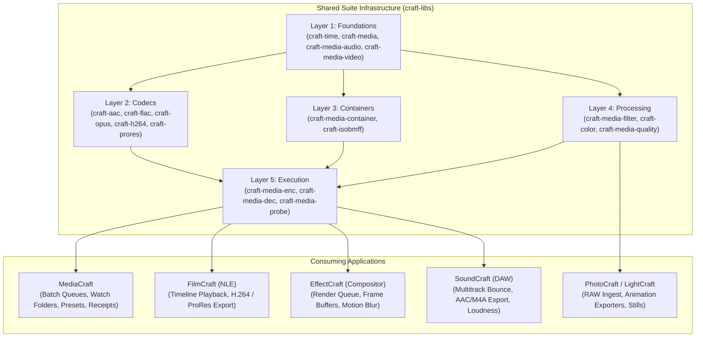
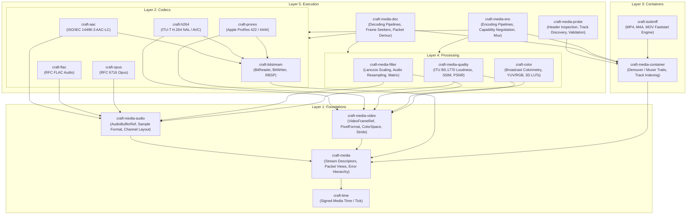
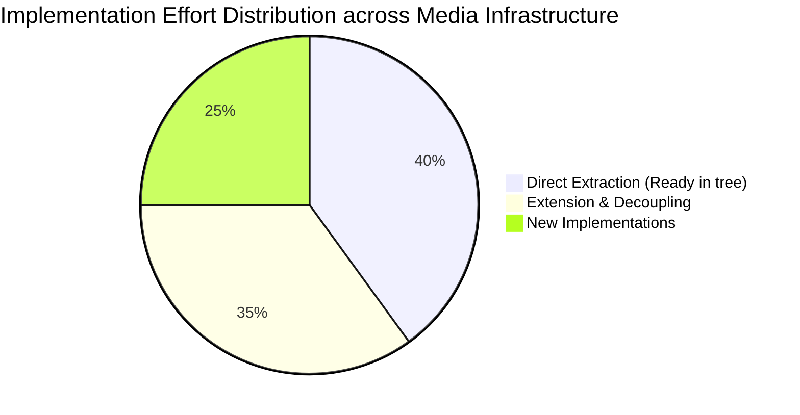
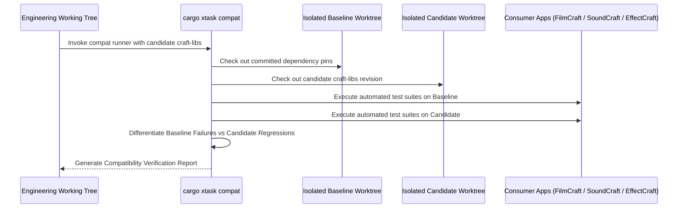
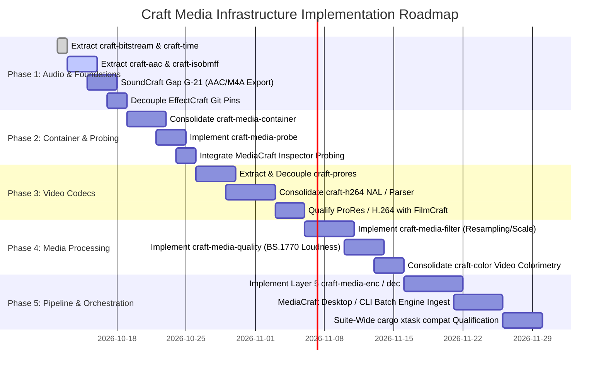

# Craft Media Infrastructure Requirements Specification

> **Specification ID:** `craft.media.infrastructure-spec`  
> **Author:** Zach Shallbetter  
> **Date:** 2026-10-12  
> **Status:** Proposed Architecture & Requirements Specification (Draft 1.0)  
> **Epistemic Classification:** *Documented Architecture & Requirements* (Subject to Maintainer Review; see Claim Taxonomy §1.1)  
> **Scope:** Shared Media Infrastructure across `craft-libs`, consuming applications (MediaCraft, FilmCraft, EffectCraft, SoundCraft, PhotoCraft, LightCraft), and headless automation runners.

---

## 1. Executive Summary & Architectural Doctrine

This document defines the authoritative architecture, capability inventory, crate boundaries, public API contracts, conformance criteria, and adoption roadmap for shared media infrastructure in the Craft application ecosystem.

### 1.1 The Core Architectural Decision: Consumption Over Ownership

A foundational principle governs this architecture:

$$\textbf{MediaCraft MUST consume shared media libraries, not own them.}$$



By establishing media processing as shared infrastructure in `craft-libs`:
1. **FilmCraft** exports H.264 and ProRes using the identical encoder pipelines that power MediaCraft's background rendering.
2. **SoundCraft** produces compressed AAC/M4A deliverables (resolving Gap G-21) and computes broadcast loudness using the same audio kernels.
3. **EffectCraft** decouples from its historical direct Git dependency pins to FilmCraft internal crates, consuming first-class, versioned shared crates.
4. **MediaCraft** functions as a high-throughput orchestration client—managing watch folders, multi-source batch queues, preset graphs, and execution receipts—without duplicating audio/video codec logic.

### 1.2 General-Purpose Library System vs Encoder Backend

The media infrastructure is designed as a **general-purpose media library system**, not merely a backend for a dedicated batch transcode utility. The identical abstractions must naturally serve:
* Non-linear video editing (random-access frame seeking, scrub caches, edit lists).
* Multitrack digital audio workstations (real-time sample-exact timing, zero-allocation playback buffers, signed preroll).
* Image composition and motion graphics (high dynamic range floating-point pixels, 3D LUTs, alpha channel preservation).
* Archival conversion and ingest validation (lossless bitstream verification, structural container probing, delivery receipts).

### 1.3 The Three Requirement Categories

To maintain clean separation between application-level UI features and suite-wide primitives, requirements are categorized into three non-overlapping tiers:

| Tier | Category | Scope | Governing Principle |
| :--- | :--- | :--- | :--- |
| **Tier 1** | **Shared Infrastructure Requirements** | Core capabilities required by two or more applications: timestamps, buffers, codec bitstreams, container muxers, color space matrices, resampling. | Lives in `craft-libs`. Zero UI, zero app-state dependencies, pure-Rust default, WebAssembly compliant. |
| **Tier 2** | **Application Requirements** | Ingest workflows, directory watchers, queue state machines, preset management, user preferences, and inspection views. | Owned exclusively by MediaCraft (or consumer apps). Must not leak into `craft-libs`. |
| **Tier 3** | **Qualification Requirements** | Bitstream conformance vectors, hostile-input fuzzing, differential oracle validation against reference decoders, and cross-app regression suites. | Enforces that shared infrastructure is empirically proven before downstream adoption. |

### 1.4 Strict Epistemic Framework & Claim Taxonomy

In accordance with `AGENTS.md` §1 and §7:

$$\text{Documented} \not\equiv \text{Implemented} \not\equiv \text{Tested} \not\equiv \text{Empirically Validated}$$

Every capability, format, and crate documented in this specification must state its verified status plainly. Unimplemented or candidate components must never be documented as ready for production use.

---

## 2. Complete Capability Inventory (Derived from Media Research)

### 2.1 Audio Subsystem Capabilities

| Capability | Specification Baseline | Dynamic Range / Channels | Conformance Target |
| :--- | :--- | :--- | :--- |
| **Linear PCM Audio** | AES3 / SMPTE 302M / RIFF | 8, 16, 24, 32-bit integer; 32, 64-bit IEEE float | Sample-exact bit-transparency; zero float drift |
| **AAC-LC Encoding/Decoding** | ISO/IEC 14496-3 (MPEG-4 Audio) | 8 kHz to 96 kHz; 1 to 8 channels (Mono up to 7.1) | 1024-sample priming calculation; edit list compensation; TDAC |
| **HE-AAC v1 / v2** | ISO/IEC 14496-3 Amd.1 / Amd.2 | SBR (Spectral Band Replication), PS (Parametric Stereo) | 2048-sample priming; bitstream header signaling |
| **FLAC (Lossless Audio)** | RFC (Free Lossless Audio Codec) | 16, 24-bit; 1 to 8 channels; 44.1 kHz to 192 kHz | Variable block sizes (1152–4608); linear prediction |
| **Opus Audio** | RFC 6716 | 6 kbps to 510 kbps; 8 kHz to 48 kHz; Mono, Stereo | SILK/CELT hybrid; 20 ms framing; speech/music optimization |
| **Broadcast Loudness** | ITU-R BS.1770-4 / EBU R128 | Integrated LUFS, Short-term LUFS, Momentary LUFS, True-Peak | K-weighting filter, gating window ($-70$ LKFS / $-10$ LU relative) |
| **Polyphase Audio Resampling** | Bandlimited sinc interpolation | Arbitrary rational ratios (e.g. 44.1 kHz $\leftrightarrow$ 48 kHz $\leftrightarrow$ 96 kHz) | SNR $> 100$ dB, passband ripple $< 0.05$ dB |
| **Channel Routing & Upmix/Downmix** | ITU-R BS.775 | 5.1/7.1 downmix to Stereo (Lo/Ro, Lt/Rt matrix); mono expansion | Energy preservation coefficients ($-3$ dB center, $-3$ dB surrounds) |

### 2.2 Video Subsystem Capabilities

| Capability | Specification Baseline | Profiles & Pixel Formats | Conformance Target |
| :--- | :--- | :--- | :--- |
| **H.264 / AVC** | ITU-T H.264 / ISO/IEC 14496-10 | Baseline, Main, High, High 10, High 4:2:2; 8/10-bit YUV | SPS/PPS parsing, CABAC/CAVLC, IDR/I/P/B slices, Annex B / AVCC |
| **Apple ProRes** | Apple ProRes Technical Brief | 422 Proxy, 422 LT, 422, 422 HQ (10-bit); 4444, 4444 XQ (12-bit) | Frame headers, slice quantizer matrices, alpha channel bitstream |
| **HEVC / H.265 (Future)** | ITU-T H.265 / ISO/IEC 23008-2 | Main, Main 10; 8/10-bit 4:2:0 YUV | VPS/SPS/PPS, CTU 64x64, tile / slice parsing |
| **Colorimetry & Primaries** | ITU-R BT.601, BT.709, BT.2020 | Full range (0–255) vs Legal/Broadcast range (16–235 / 16–240) | ITU matrix conversions; 10/12-bit clamping bounds |
| **Transfer Functions** | ITU-R BT.709, BT.1886, ST 2084 (PQ), STD-B67 (HLG) | Linear $\leftrightarrow$ non-linear optical-electrical / electrical-optical | Exact rational exponent curves; SMPTE ST 2084 constants |
| **Spatial Scaling** | Sinc, Lanczos3, Bicubic, Bilinear | Planar YUV and RGB pixel buffers | Bounded anti-aliasing; zero ringing overflow |
| **Frame Rate Conversion** | Rational timebase interpolation | 23.976, 24.0, 25.0, 29.97, 30.0, 50.0, 59.94, 60.0 fps | Drop-frame timecode matching; pulldown cadence handling |

### 2.3 Containers & Multiplexing Capabilities

| Container | Specification Baseline | Atoms / Elements Handled | Conformance Target |
| :--- | :--- | :--- | :--- |
| **ISOBMFF (MP4 / M4A / MOV)** | ISO/IEC 14496-12 / Apple QuickTime | `ftyp`, `moov`, `mvhd`, `trak`, `mdia`, `minf`, `stbl`, `mdat` | Faststart progressive muxing (`moov` before `mdat`), `co64`, `elst` |
| **Broadcast WAVE (BWF / RF64)** | EBU Tech 3285 / ITU-R BS.2088 | `fmt `, `data`, `bext`, `cart`, `ds64` (> 4 GB files), `axml` | BWF time reference, originator metadata, RF64 chunk sizes |
| **Raw Bitstream Containers** | ADTS (AAC), Annex B (H.264), Ogg | Syncword framing, CRC checking, packet encapsulation | Non-allocating packet streaming; malformed-frame recovery |
| **Still Sequences** | DPX (SMPTE 268M), OpenEXR, TIFF | 10-bit logarithmic, 16-bit half, 32-bit float, uncompressed RGB | Frame numbering patterns (`%06d`), timecode header metadata |

---

## 3. Five-Layer Architectural Model & Dependency Graph

The media infrastructure is organized strictly into five horizontal layers. Crates at layer $N$ may depend only on crates at layer $< N$. Circular dependencies between layers or between crates in the same layer are strictly forbidden.



### 3.1 Layer Responsibilities & Boundaries

1. **Foundations (Layer 1)**: Defines media time, stream descriptors, channel layouts, buffer views, planar strides, and unified error types. Absolutely no codec algorithms, container parsing, file I/O, or OS threading. Must compile to `wasm32-unknown-unknown` without warnings.
2. **Codecs (Layer 2)**: Elementary stream decoders and encoders. Operates strictly on packets and uncompressed buffer slices. Independent of container formats (`craft-aac` knows nothing about MP4 `moov` atoms; `craft-h264` processes NAL units, not ISOBMFF sample tables).
3. **Containers (Layer 3)**: Multiplexing and demultiplexing. Manages packet timing, track offsets, edit lists, atom headers, and sample indexes. Does not decompress audio or video frames.
4. **Processing (Layer 4)**: Mathematical transformation kernels for audio and video buffers: polyphase resampling, channel mixing, 2D spatial scaling, broadcast range legalizing, and objective quality/loudness analysis.
5. **Execution (Layer 5)**: High-level pipeline drivers coordinating demuxing, decoding, filtering, encoding, and muxing. Implements capability negotiation, resource limits, and progress reporting.

---

## 4. Cross-Repository Implementation Inventory (Crate Audit Baseline)

As established in [`CRATE_AUDIT.md`](CRATE_AUDIT.md), existing Craft repositories already contain mature, tested media implementations. Extracting and consolidating these implementations prevents redundant engineering and resolves downstream gaps immediately.

| Repository | Current Internal Crate | Implemented Capabilities | Test Evidence & Status | Target Extraction Crate |
| :--- | :--- | :--- | :--- | :--- |
| **FilmCraft** | `crates/bitstream` | `BitReader`, `BitWriter`, Exp-Golomb, byte alignment | 8 unit tests passing; zero unsafe | `craft-bitstream` |
| **FilmCraft** | `crates/aac` | AAC-LC encoder & decoder; CBR & VBR; 1–8 channels; priming calculation | 31 unit tests passing; TDAC verified; FFmpeg oracle match; WASM clean | `craft-aac` |
| **FilmCraft** | `crates/isobmff` | Progressive faststart MP4/M4A muxer & demuxer; `elst` priming edit | 62 unit tests passing; atom verification | `craft-isobmff` |
| **FilmCraft** | `crates/h264` | NAL unit parser, SPS/PPS decoder, baseline/main slice parser | Unit tests in-tree; decodes frame headers | `craft-h264` |
| **FilmCraft** | `crates/prores` | ProRes 422/4444 frame header parser, quantizer matrix decoder | Unit tests in-tree | `craft-prores` |
| **FilmCraft** | `crates/color` | Broadcast colorimetry (Rec.709, Rec.2020, transfer curves, legal range) | Verified in timeline playback | `craft-color` (video subset) |
| **SoundCraft** | `crates/audio-io` | Broadcast WAV, AIFF, FLAC reader and writer; metadata tagging | Verified in Bounce Mix; Gap G-21 pending | `craft-media-audio` & `craft-flac` |
| **SoundCraft** | `crates/dsp` | Biquad filters, bandlimited polyphase resampler, stereo pan law | Production DAW audio engine | `craft-media-filter` (audio) |
| **EffectCraft** | `crates/export` | Direct git consumption of FilmCraft codecs; queue management | Active production usage | Consumer of Layer 5 `craft-media-enc` |

---

## 5. Explicit Crate Boundaries & Public API Contracts

Every crate in `craft-libs` enforces ecosystem non-negotiables:
* `#![forbid(unsafe_code)]`
* `#![deny(clippy::unwrap_used, clippy::expect_used, clippy::panic, clippy::unimplemented, clippy::todo, clippy::unreachable)]`
* Strict compile-time WebAssembly support (`wasm32-unknown-unknown`).
* Typed domain error hierarchies using `thiserror`.

### 5.1 Layer 1: Foundations

#### `craft-media` (Stream Descriptors & Core Types)

```rust
// craft-media/src/time.rs
use craft_time::Tick;

/// Rational timestamp representation preserving sample-exact media time.
#[derive(Debug, Clone, Copy, PartialEq, Eq, PartialOrd, Ord, Hash)]
pub struct MediaTime {
    /// Numerator ticks (signed to support preroll and negative lead-in bars).
    pub ticks: i64,
    /// Timebase denominator in Hertz (e.g. 48000, 96000, 10000000).
    pub timebase: u32,
}

impl MediaTime {
    pub const ZERO: Self = Self { ticks: 0, timebase: 1 };

    pub fn new(ticks: i64, timebase: u32) -> Result<Self, MediaError> {
        if timebase == 0 {
            return Err(MediaError::InvalidTimebase);
        }
        Ok(Self { ticks, timebase })
    }

    /// Lossless conversion to craft-time::Tick.
    pub fn to_tick(self) -> Tick {
        Tick::from_rational(self.ticks, self.timebase as i64)
    }
}
```

```rust
// craft-media/src/stream.rs
#[derive(Debug, Clone, PartialEq, Eq)]
pub enum MediaType {
    Audio,
    Video,
    Subtitle,
    Data,
}

#[derive(Debug, Clone, PartialEq, Eq)]
pub struct StreamDescriptor {
    pub stream_id: u32,
    pub media_type: MediaType,
    pub codec_id: String,
    pub timebase: u32,
    pub duration: Option<MediaTime>,
    pub extra_data: Vec<u8>,
}
```

#### `craft-media-audio` (Audio Buffers & Channel Layouts)

```rust
// craft-media-audio/src/buffer.rs
#[derive(Debug, Clone, Copy, PartialEq, Eq)]
pub enum SampleFormat {
    U8,
    I16,
    I24,
    I32,
    F32,
    F64,
}

#[derive(Debug, Clone, Copy, PartialEq, Eq)]
pub enum ChannelLayout {
    Mono,
    Stereo,
    Surround3_0,
    Surround4_0,
    Surround5_1,
    Surround7_1,
    Custom(u8),
}

impl ChannelLayout {
    pub fn channel_count(&self) -> usize {
        match self {
            Self::Mono => 1,
            Self::Stereo => 2,
            Self::Surround3_0 => 3,
            Self::Surround4_0 => 4,
            Self::Surround5_1 => 6,
            Self::Surround7_1 => 8,
            Self::Custom(c) => *c as usize,
        }
    }
}

/// Zero-copy non-allocating planar audio view.
pub struct PlanarAudioView<'a> {
    pub channels: &'a [&'a [f32]],
    pub sample_rate: u32,
    pub frame_count: usize,
}
```

#### `craft-media-video` (Video Frame Buffers & Strides)

```rust
// craft-media-video/src/frame.rs
#[derive(Debug, Clone, Copy, PartialEq, Eq)]
pub enum PixelFormat {
    Yuv420p,
    Yuv422p,
    Yuv444p,
    Yuv422p10Le,
    Rgb24,
    Rgba32,
    Bgra32,
}

#[derive(Debug, Clone, Copy, PartialEq, Eq)]
pub enum ColorSpace {
    Bt601,
    Bt709,
    Bt2020,
}

#[derive(Debug, Clone, Copy, PartialEq, Eq)]
pub enum ColorRange {
    Full,
    Limited, // 16-235 for Y, 16-240 for UV
}

pub struct VideoPlaneRef<'a> {
    pub data: &'a [u8],
    pub stride: usize,
    pub width: usize,
    pub height: usize,
}

pub struct VideoFrameRef<'a> {
    pub planes: &'a [VideoPlaneRef<'a>],
    pub format: PixelFormat,
    pub color_space: ColorSpace,
    pub color_range: ColorRange,
    pub pts: MediaTime,
}
```

---

### 5.2 Layer 2: Codecs

#### `craft-aac` (Pure-Rust AAC-LC)

```rust
// craft-aac/src/lib.rs
pub struct AacEncoderConfig {
    pub sample_rate: u32,
    pub channels: ChannelLayout,
    pub bitrate_mode: BitrateMode,
}

#[derive(Debug, Clone, Copy)]
pub enum BitrateMode {
    Cbr { target_kbps: u32 },
    Vbr { quality_factor: f32 }, // 1.0 to 5.0
}

pub struct AacEncoder {
    config: AacEncoderConfig,
    // internal MDCT / psychoacoustic state
}

impl AacEncoder {
    pub fn new(config: AacEncoderConfig) -> Result<Self, AacError>;
    
    /// Returns exact priming delay samples (1024 for AAC-LC).
    pub fn priming_samples(&self) -> u32 {
        1024
    }

    /// Feeds planar f32 samples and drains encoded access units.
    pub fn encode_frame(
        &mut self,
        samples: &PlanarAudioView<'_>,
        output_buffer: &mut Vec<u8>,
    ) -> Result<usize, AacError>;

    /// Generates AudioSpecificConfig (ASC) for container muxers.
    pub fn audio_specific_config(&self) -> Result<Vec<u8>, AacError>;
}
```

#### `craft-prores` (Apple ProRes Codec)

```rust
// craft-prores/src/lib.rs
#[derive(Debug, Clone, Copy, PartialEq, Eq)]
pub enum ProResProfile {
    Proxy,
    Lt,
    Standard,
    Hq,
    ProRes4444,
    ProRes4444Xq,
}

pub struct ProResEncoderConfig {
    pub profile: ProResProfile,
    pub width: usize,
    pub height: usize,
    pub interlaced: bool,
}

pub struct ProResEncoder {
    config: ProResEncoderConfig,
}

impl ProResEncoder {
    pub fn new(config: ProResEncoderConfig) -> Result<Self, ProResError>;
    
    pub fn encode_frame(
        &mut self,
        frame: &VideoFrameRef<'_>,
        output_buffer: &mut Vec<u8>,
    ) -> Result<usize, ProResError>;
}
```

---

### 5.3 Layer 3: Containers

#### `craft-isobmff` (MP4/M4A/MOV Multiplexing)

```rust
// craft-isobmff/src/muxer.rs
pub struct Mp4Muxer<W: std::io::Write + std::io::Seek> {
    writer: W,
    faststart: bool,
    tracks: Vec<MuxTrack>,
}

impl<W: std::io::Write + std::io::Seek> Mp4Muxer<W> {
    pub fn new(writer: W, faststart: bool) -> Self;

    pub fn add_audio_track(
        &mut self,
        codec: AudioCodecTag,
        timebase: u32,
        extra_data: &[u8],
        priming_delay_samples: u32,
    ) -> Result<TrackId, IsoBmffError>;

    pub fn add_video_track(
        &mut self,
        codec: VideoCodecTag,
        timebase: u32,
        width: u32,
        height: u32,
        extra_data: &[u8],
    ) -> Result<TrackId, IsoBmffError>;

    pub fn write_sample(
        &mut self,
        track_id: TrackId,
        packet: &MediaPacket,
    ) -> Result<(), IsoBmffError>;

    /// Finalizes the container. If faststart is enabled, relocates the `moov`
    /// atom prior to `mdat` and rewrites 64-bit chunk offsets (`co64`).
    pub fn finish(mut self) -> Result<(), IsoBmffError>;
}
```

---

### 5.4 Layer 4: Processing

#### `craft-media-filter` & `craft-media-quality`

```rust
// craft-media-filter/src/resample.rs
pub struct AudioResampler {
    in_rate: u32,
    out_rate: u32,
    channels: usize,
    // polyphase FIR filter banks
}

impl AudioResampler {
    pub fn new(in_rate: u32, out_rate: u32, channels: usize) -> Result<Self, FilterError>;
    pub fn process(
        &mut self,
        input: &PlanarAudioView<'_>,
        output: &mut [Vec<f32>],
    ) -> Result<usize, FilterError>;
}

// craft-media-quality/src/loudness.rs
pub struct LoudnessMeter {
    sample_rate: u32,
    // ITU-R BS.1770-4 K-weighting biquad states
}

pub struct LoudnessReport {
    pub integrated_lufs: f32,
    pub short_term_lufs: f32,
    pub momentary_lufs: f32,
    pub true_peak_dbfs: f32,
    pub loudness_range_lu: f32,
}

impl LoudnessMeter {
    pub fn new(sample_rate: u32, channels: ChannelLayout) -> Result<Self, QualityError>;
    pub fn process_block(&mut self, samples: &PlanarAudioView<'_>) -> Result<(), QualityError>;
    pub fn finalize(&self) -> LoudnessReport;
}
```

---

### 5.5 Layer 5: Execution

#### `craft-media-enc` (Unified Pipeline Coordinator)

```rust
// craft-media-enc/src/pipeline.rs
pub struct EncodingPipeline {
    demuxer: Box<dyn Demuxer>,
    decoders: HashMap<StreamId, Box<dyn Decoder>>,
    filters: Vec<Box<dyn MediaFilter>>,
    encoders: HashMap<StreamId, Box<dyn Encoder>>,
    muxer: Box<dyn Muxer>,
}

impl EncodingPipeline {
    pub fn step(&mut self) -> Result<PipelineStatus, PipelineError>;
    pub fn progress(&self) -> PipelineProgress;
    pub fn cancel(&mut self);
}

pub enum PipelineStatus {
    Running,
    Finished,
    Yielded,
}

pub struct PipelineProgress {
    pub processed_pts: MediaTime,
    pub total_duration: Option<MediaTime>,
    pub instantaneous_fps: f32,
    pub encoded_bytes: u64,
}
```

---

## 6. Gap Analysis: Extraction vs. Extension vs. New Implementation



### 6.1 Category 1: Direct Extraction (Existing Code Decoupled to `craft-libs`)

* **`craft-bitstream`**: Direct extraction from `filmcraft/crates/bitstream`. Zero domain coupling.
* **`craft-aac`**: Direct extraction from `filmcraft/crates/aac`. Pure-Rust AAC-LC encoder/decoder. Passes 31 unit tests and FFmpeg oracle checks.
* **`craft-isobmff`**: Direct extraction from `filmcraft/crates/isobmff`. Pure-Rust faststart MP4/M4A muxer/demuxer. Passes 62 unit tests.

### 6.2 Category 2: Extension & Decoupling (Consolidation of Existing Divergent Code)

* **`craft-h264`**: Extract NAL unit and SPS/PPS parsing from `filmcraft/crates/h264`. Extend with standalone slice parsing and baseline macroblock encoder for proxy generation.
* **`craft-prores`**: Extract frame header parsing from `filmcraft/crates/prores`. Extend with multi-profile quantizer matrices to enable ProRes 422 / 4444 encoding.
* **`craft-media-audio` & `craft-flac`**: Generalize `soundcraft/crates/audio-io` buffer models into zero-copy planar views; decouple FLAC block encoder from DAW session state.
* **`craft-color`**: Consolidate broadcast video matrices from `filmcraft/crates/color` and ICC color spaces from `photocraft-color` / `craft-cms`.

### 6.3 Category 3: New Implementations

* **`craft-opus`**: Pure-Rust RFC 6716 Opus audio encoder/decoder for streaming and web delivery presets.
* **`craft-media-filter`**: Multi-threaded Lanczos3 spatial scaling and SIMD-accelerated YUV $\leftrightarrow$ RGB format conversion.
* **`craft-media-quality`**: Pure-Rust ITU-R BS.1770-4 K-weighting loudness measurement and True-Peak detector.
* **`craft-media-probe`**: Unified container inspector and stream metadata extractor used by MediaCraft's Inspector panel.

---

## 7. Conformance Requirements for Codecs & Containers

Every shared media crate must pass rigorous conformance qualification before downstream promotion.

### 7.1 Codec Bitstream Conformance

1. **AAC Conformance (ISO/IEC 14496-26)**:
   * Bit-exact Time-Domain Aliasing Cancellation (TDAC) verification.
   * Priming compensation: verified 1024-sample leading zero delay matching ISO specification.
   * Edit list (`elst`) synchronization: round-trip container muxing must recover identical PCM sample counts without audio drift.
2. **H.264 Conformance (ISO/IEC 14496-4)**:
   * Compliant NAL unit encapsulation (`nal_unit_type`, `nal_ref_idc`).
   * Valid SPS/PPS parameter sets matching target profile and level limits.
   * IDR recovery point signaling for random-access seeking.
3. **Apple ProRes Conformance**:
   * Apple ProRes bitstream syntax compliance (frame header, picture header, slice dimensions, DC/AC quantizer matrices).
   * Verified pixel decode match against Apple QuickTime Pro / Final Cut Pro reference decoders within 1 LSB tolerance.

### 7.2 Container Integrity & Faststart Multiplexing

1. **ISOBMFF Progressive Faststart**:
   * File structure must place `ftyp` followed immediately by `moov`, with `mdat` following `moov`.
   * When `mdat` exceeds $2^{32} - 1$ bytes, atom offsets must automatically upgrade to 64-bit chunk offset atoms (`co64`).
   * No broken box sizing: every box `size` field must strictly match parsed children byte counts.

### 7.3 Hostile Input & Fuzz Testing

* **Zero Panic Tolerance**: All decoders and demuxers must run under `cargo-fuzz` against mutated bitstreams. Truncated files, random bit flips, out-of-bounds atom lengths, and malformed NAL headers must return typed `Err(MediaError)` without panicking or allocating unbounded memory.
* **Safe Arithmetic**: All timestamp calculations, frame byte offsets, and buffer indices must use `checked_*` or `saturating_*` integer arithmetic.

### 7.4 WebAssembly Conformance

* All Layer 1, Layer 2, Layer 3, and Layer 4 crates must build cleanly for WebAssembly:
  ```bash
  cargo check --target wasm32-unknown-unknown
  ```
* Platform-specific I/O or multi-threading must be guarded behind `#[cfg(not(target_arch = "wasm32"))]` with deterministic single-threaded fallbacks.

---

## 8. Cross-Application Adoption Requirements (`cargo xtask compat`)

Shared infrastructure adoption must follow the Craft Suite Compatibility Protocol defined in `AGENTS.md` §5 and `rules/ci.md`.



### 8.1 Adoption Non-Negotiables

1. **Candidate Revision Testing**: Proposed revisions must be tested against real consumer applications without modifying committed dependency pins or lockfiles in git.
2. **Ephemeral Worktree Isolation**: Builds run in temporary directories that are cleaned up automatically upon exit.
3. **Zero Consumer Regressions**:
   * **FilmCraft**: All 54 internal crates must pass `cargo test --workspace`. Timeline playback, scrubbing, and export must show zero regressions.
   * **EffectCraft**: Decoupling from FilmCraft git pins to `craft-libs` must pass all compositor render queue tests.
   * **SoundCraft**: Gap G-21 must be resolved (enabling AAC/M4A export) with 100% pass on existing WAV/FLAC bounce tests and objective SNR $> 45$ dB.
4. **Exact Provenance**: Compatibility reports must record exact git commit SHAs, cargo tree resolutions, and target architecture metadata.

---

## 9. Phased Implementation Roadmap

The consolidation progresses through five structured phases to ensure stability at each milestone.



### 9.1 Phase Details

* **Phase 1: Foundations & Compressed Audio (Milestone 1)**:
  * Extract `craft-bitstream`, `craft-media`, `craft-aac`, and `craft-isobmff` into `craft-libs`.
  * Enable AAC/M4A compressed export in SoundCraft (`soundcraft-audio-io`), resolving Gap G-21.
  * Decouple EffectCraft from its FilmCraft git pins by pointing to `craft-libs`.
* **Phase 2: Containers & Probing (Milestone 2)**:
  * Formulate `craft-media-container` traits.
  * Implement `craft-media-probe` for deep header inspection and metadata extraction.
  * Wire MediaCraft's Inspector panel to `craft-media-probe`.
* **Phase 3: Video Codec Consolidation (Milestone 3)**:
  * Extract `craft-prores` and `craft-h264`.
  * Validate bitstreams against Apple ProRes and ITU-T H.264 reference vectors.
  * Ensure FilmCraft timeline playback uses the consolidated crates.
* **Phase 4: Media Processing & Quality Kernels (Milestone 4)**:
  * Implement `craft-media-filter` for multi-threaded Lanczos video scaling and polyphase audio resampling.
  * Implement `craft-media-quality` for ITU BS.1770-4 loudness measurement.
  * Consolidate broadcast color models in `craft-color`.
* **Phase 5: Execution Pipelines & Full Suite Orchestration (Milestone 5)**:
  * Implement `craft-media-enc` and `craft-media-dec` execution pipelines.
  * Connect MediaCraft desktop and headless CLI to `craft-media-enc` for batch queue transcoding, watch folder automation, and export receipts.
  * Execute comprehensive `cargo xtask compat` suite run across all 10 Craft applications.
